# Tài liệu firmware: Smart Home Panel (GUITION ESP32-4848S040)

Panel điều khiển nhà thông minh trên màn hình cảm ứng 4" 480×480, gồm:

- Giao diện LVGL 9: 3 tab (Tổng quan, Điều khiển, Cài đặt) và các trang con
  (Wi-Fi, Mạng & MQTT, Hệ thống, Thẻ nhớ, lịch sử cảm biến, nhật ký, trình xem
  tệp), màn hình khởi động và màn hình chờ mang nhận diện Bách Khoa.
- Firmware chạy trên FreeRTOS: 6 task, cộng 2 luồng vẽ LVGL trên 2 nhân.
- Điều khiển relay trên panel; thiết bị Tasmota điều khiển qua web
  `smarthome.blong.id.vn` (panel chỉ cần Internet).
- Thẻ nhớ TF và LittleFS: log, cấu hình, lịch sử cảm biến, cập nhật và sao lưu
  firmware. PSRAM giữ lịch sử 24 giờ / 7 ngày và 400 sự kiện gần nhất.

| Khởi động | Tổng quan (bộ màu Bách Khoa) | Điều khiển | Cài đặt |
|---|---|---|---|
| 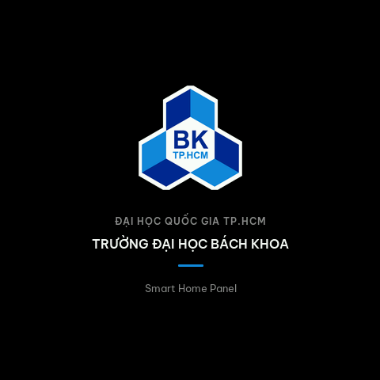 | 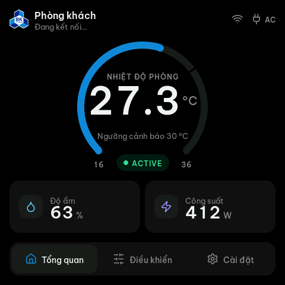 | 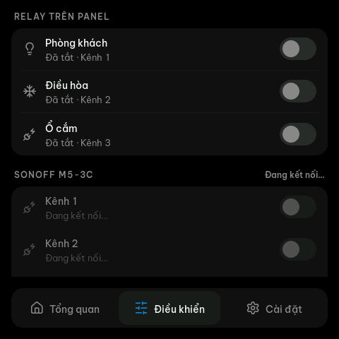 | 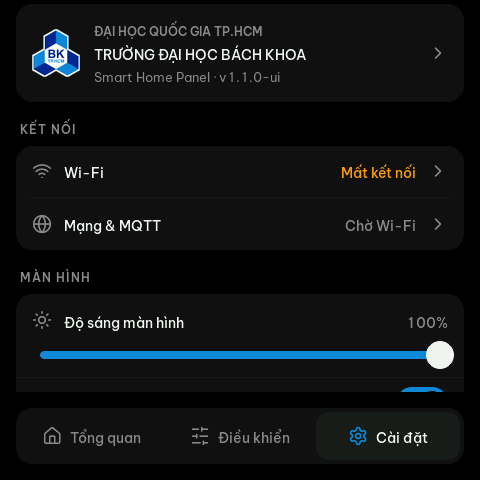 |

### Toàn bộ màn hình (`docs/images/`)

| | | | |
|---|---|---|---|
| **Tổng quan** 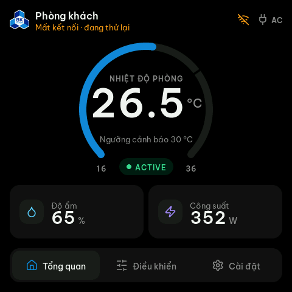 | **Bộ màu Ember** 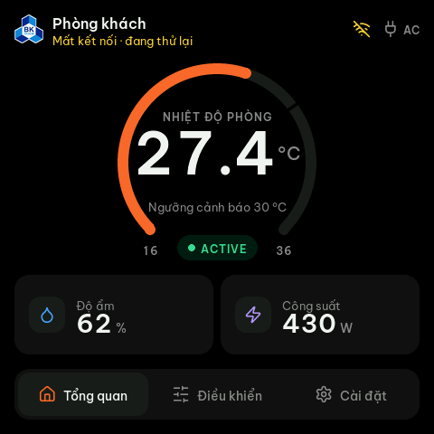 | **Màn hình chờ**  | **Khởi động**  |
| **Điều khiển**  | **Điều khiển (cuộn)** 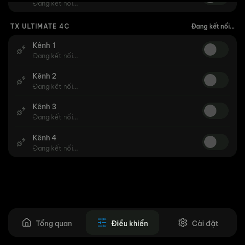 | **Cài đặt**  | **Cài đặt (cuộn)** 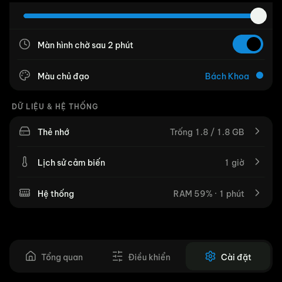 |
| **Wi-Fi** 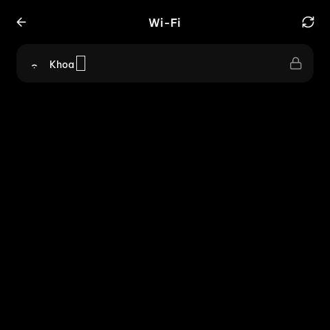 | **Nhập mật khẩu** 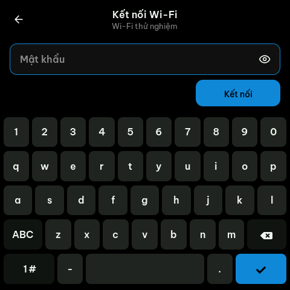 | **Mạng mở** 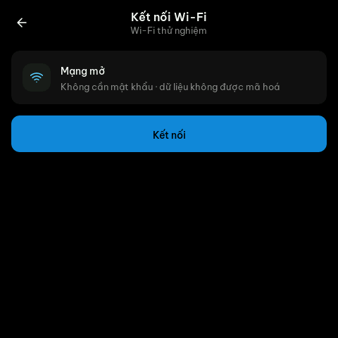 | **Mạng & MQTT** 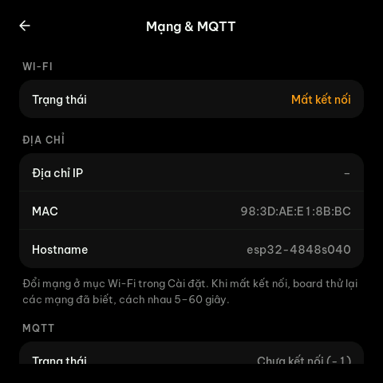 |
| **Hệ thống** 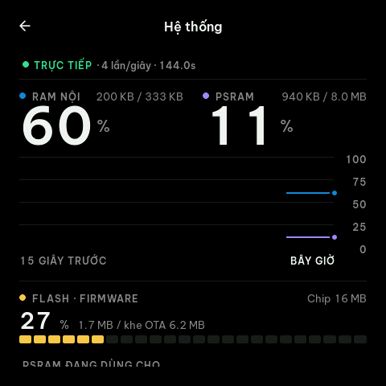 | **Hệ thống (cuộn)** 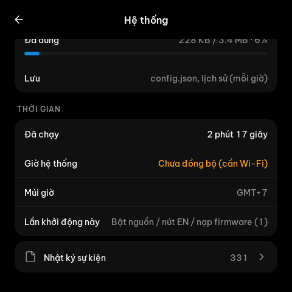 | **Lịch sử cảm biến** 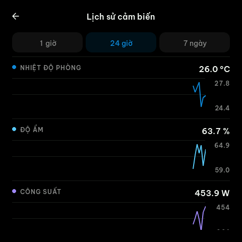 | **Nhật ký sự kiện** 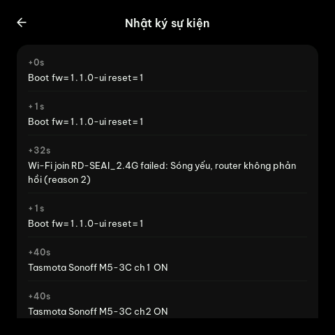 |
| **Thẻ nhớ** 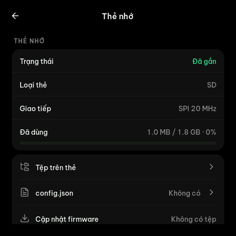 | **config.json** 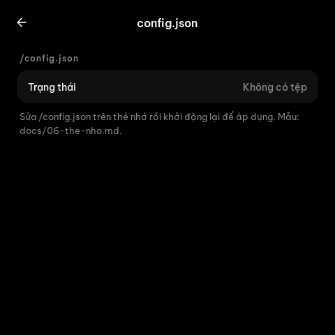 | **Tệp trên thẻ** 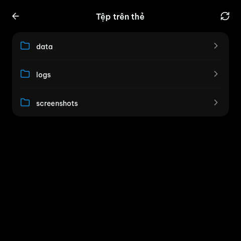 | **Giới thiệu** 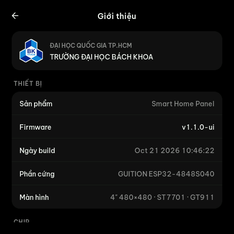 |
| **Xem CSV (bảng)** 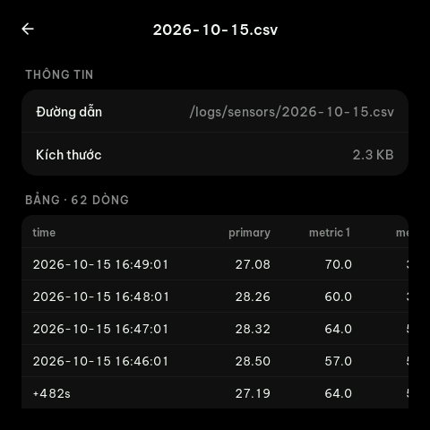 | **Xem văn bản** 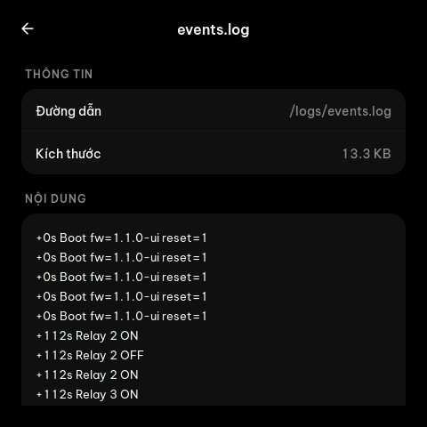 | **Xem ảnh** 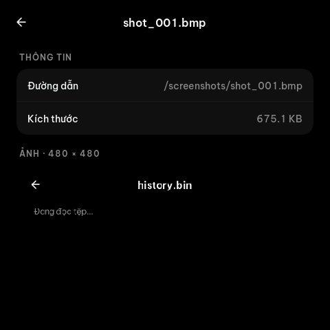 | |

*(Chụp ngày 21/10/2026 qua COM4 bằng lệnh `shot` (`tools/screenshot.py`), firmware
v1.1.0-ui. Lúc chụp panel không có Wi-Fi, nên Tasmota hiện "Đang kết nối…".)*

---

## Mục lục

| # | Tài liệu | Nội dung |
|---|---|---|
| 1 | [Phần cứng & chân pin](01-phan-cung.md) | Board, module, bảng GPIO đã kiểm chứng, thẻ nhớ, relay, anten Wi-Fi |
| 2 | [Build & nạp firmware](02-build-nap.md) | `platformio.ini` bắt buộc, lỗi flash 8/16 MB, serial UART0, cổng COM, OTA |
| 3 | [Kiến trúc FreeRTOS](03-kien-truc-rtos.md) | 6 task, queue, mutex, watchdog, luồng dữ liệu, bản đồ mã nguồn |
| 4 | [Giao diện HMI (LVGL)](04-giao-dien-hmi.md) | Màn hình, bố cục, trạng thái, bộ màu, font, icon, cách mở rộng |
| 5 | [Kết nối: Wi-Fi, MQTT, Tasmota](05-ket-noi.md) | Wi-Fi manager, mạng mở/đã lưu, topic/payload MQTT, Tasmota qua web, NTP, OTA |
| 6 | [Thẻ nhớ](06-the-nho.md) | Cấu trúc thẻ, `config.json`, log, cập nhật/sao lưu firmware, xem tệp, LittleFS, PSRAM |
| 7 | [Gỡ lỗi & xử lý sự cố](07-go-loi.md) | Lệnh serial, chụp màn hình, đọc log, mã reset, bảng triệu chứng |
| 8 | [Nhật ký thay đổi & vấn đề đã gặp](08-nhat-ky.md) | Các lỗi đã tìm ra, nguyên nhân, cách sửa, theo thứ tự thời gian |

---

## Làm nhanh

```bash
cd firmware
pio run -t upload --upload-port COM4    # đổi COMx theo máy (xem 02-build-nap.md)
pio device monitor -p COM4 -b 115200
python tools/screenshot.py COM4 shot.png
```

Log khởi động bình thường:

```
=== ESP32-4848S040 Smart Home Panel ===
Firmware: 1.1.0-ui  Hardware: 1.0
Reset reason: 1
SD: mounted at 20000000 Hz, 1892 MB
LittleFS: mounted, 228 / 3456 KB used
history: restored (seq N)
[event] Boot fw=1.1.0-ui reset=1
Tasmota: 2 device(s) via https://smarthome.blong.id.vn/api/tasmota
Tasks started: ui app net devices storage console
WiFi: 2 known network(s)
WiFi:    -57 dBm ch1  WPA  RFThings VietNam
WiFi:    -77 dBm ch1  open RD-SEAI_2.4G
WiFi: scan found 7 networks
WiFi: trying RFThings VietNam
[event] Wi-Fi connected: RFThings VietNam 192.168.130.171 RSSI -55
```

---

## Trạng thái hiện tại (21/10/2026)

### Đã kiểm chứng trên board thật

| Hạng mục | Cách kiểm chứng |
|---|---|
| Boot, serial log qua CH340 | log khởi động đầy đủ |
| LCD + LVGL 9, mọi trang, 4 bộ màu | ảnh chụp trong `docs/images/` |
| Cảm ứng GT911, cuộn, bàn phím | log `TOUCH DOWN/UP`, người dùng thao tác trực tiếp |
| Vẽ: vẽ lại toàn màn hình 55 ms (trước 100 ms), không rác hình khi chuyển cảnh | lệnh `bench`, `shot fb` |
| Thẻ nhớ, LittleFS, lịch sử cảm biến lưu/nạp lại | log, khởi động lại |
| Xem tệp: CSV dạng bảng, ảnh BMP, văn bản 64 KB | ảnh chụp |
| Độ sáng (0–100%, đèn thật 50–100%), màn hình chờ sau 2 phút | thao tác, log bộ đếm |
| Điều khiển Tasmota qua web (Sonoff M5-3C, TX Ultimate 4C) | lệnh `devices`: 22 lần hỏi / 40 s, 0 lỗi, khoảng 0,4 s; người dùng bật/tắt từ panel |

### Chưa kiểm chứng / còn tồn tại

| Hạng mục | Lý do / việc cần làm |
|---|---|
| **Wi-Fi tại chỗ đặt panel** | Panel bắt sóng yếu hơn laptop nhiều; RD-SEAI_2.4G ở -77 dBm không vào được. Cần đặt panel nơi có mạng mạnh (05-ket-noi.md, mục 5.1) |
| MQTT | Broker `192.168.1.100` trong `config.h` không thuộc mạng nào đang dùng. Cần địa chỉ broker thật |
| Cập nhật firmware từ thẻ nhớ, `sd restore` | Chưa thử với `firmware.bin` thật |
| Xem ảnh JPG/PNG | Mới thử BMP; cần ảnh thật trên thẻ |
| Cảm biến thật | Chưa nối. Số liệu đang **giả lập** (`HMI_SIMULATE_SENSORS 1`) |

---

## Bản thiết kế

Bản thiết kế UI/UX (Home Dashboard, các trạng thái, design system, pixel specs)
nằm trên canvas **"ESP32 480 HMI"**. Firmware hiện tại khác canvas ở các điểm:

- Tab giữa là **Điều khiển** (relay + Tasmota) thay cho "Chỉ số".
- Có 4 bộ màu Lime / Ember / Cobalt / Bách Khoa trên nền đen-xám, thay cho bảng màu teal ban đầu.
- Có logo Bách Khoa ở màn khởi động, header và mục Giới thiệu.
- Có thêm màn hình Wi-Fi, các trang con của Cài đặt, lịch sử cảm biến, trình
  xem tệp và màn hình chờ.
